# Feature Flows and ERD

Dokumen ini merangkum flow fitur yang aktif di aplikasi saat ini berdasarkan implementasi di `routes/web.php`, controller, model Eloquent, dan feature flag yang aktif pada `2026-04-04`.

## Scope

- Cakupan fitur aktif:
  - Authentication, password change, pending approval, role-based access
  - Risk Monitoring, Heatmap, Recap, Trend Analysis
  - Risk Register, Risk Detail, RCSA, comments, attachments, status approval
  - KRI
  - Mitigation Playbooks, Mitigation Kanban, deadline alerts
  - BCM: BIA dan BCP
  - Third-Party Vendors
  - Corporate Risk Appetite Framework
  - Incident Management
  - Threat Intelligence
  - Audit Dashboard
  - Compliance Work Programs
  - Manual Export dan Scheduled Reports
  - Superadmin Governance
- Fitur yang sengaja tidak dimasukkan ke flow utama:
  - OJK Mitigation, karena saat ini di-hide oleh feature flag.
- Catatan penting:
  - `risk_owner` di aplikasi adalah label bisnis/divisi, bukan foreign key ke tabel `users`.
  - Threat Intelligence terutama dibangun dari service + cache + external feeds, bukan model Eloquent permanen.
  - Audit Dashboard import menggunakan session-backed imported rows sebelum dirender/export.

## Feature Map

| Feature | Main Route | Main Model / Service |
| --- | --- | --- |
| Auth & Access | `/login`, `/change-password`, `/account/pending-approval` | `User` |
| Risk Monitoring | `/risk-monitoring` | `Risk`, `RiskInherentAnalysis`, `RiskResidualAnalysis` |
| Heatmap / Recap / Trend | `/risk-heatmap`, `/risk-recap`, `/trend-analysis` | `Risk`, `RadarGroup`, `RiskQuantProfile` |
| Risk Register | `/risks` | `Risk` |
| RCSA Workspace | `/risks/{risk}/rcsa` | `RiskRcsaWorkspace` |
| KRI | `/kris` | `Kri`, `KriLog` |
| Mitigation Kanban | `/mitigation-kanban` | `RiskTreatment`, `RiskAlert` |
| Mitigation Playbooks | `/mitigation-playbooks` | `RiskTreatmentTemplate` |
| BCM | `/bcm` | `Bia`, `Bcp` |
| Vendors | `/vendors` | `Vendor` |
| Corporate Risk Appetite | `/risk-appetites` | `RiskAppetite`, `RiskAppetiteEvaluator` |
| Incident Management | `/incident-management` | `RiskIncident` |
| Threat Intelligence | `/threat-intelligence` | `ThreatIntelligenceService` |
| Audit Dashboard | `/audit` | `AuditDashboardDataService`, spreadsheet import service |
| Compliance Programs | `/compliance/*` | `ComplianceWorkProgram` |
| Manual Export | `/reports/{scope}/{format}` | `ReportDataService` |
| Scheduled Reports | `/reports/scheduled` | `ScheduledReport`, `ScheduledReportRun`, dispatch service |
| Superadmin Governance | `/users`, `/risk-status-approvals`, `/risk-alerts`, `/audit-logs` | `User`, `RiskStatusChangeRequest`, `RiskAlert`, `AuditLog` |

## 1. Authentication, Password Change, Pending Approval, and Access


[Source Mermaid](diagrams/src/01-authentication-password-change-pending-approval-and-access.mmd)

## 2. Risk Monitoring, Heatmap, Recap, and Trend Analysis


[Source Mermaid](diagrams/src/02-risk-monitoring-heatmap-recap-and-trend-analysis.mmd)

## 3. Risk Register Core Lifecycle


[Source Mermaid](diagrams/src/03-risk-register-core-lifecycle.mmd)

## 4. Risk Governance, Comments, Attachments, and Status Approval


[Source Mermaid](diagrams/src/04-risk-governance-comments-attachments-and-status-approval.mmd)

## 5. KRI Flow


[Source Mermaid](diagrams/src/05-kri-flow.mmd)

## 6. Mitigation Playbooks, Treatments, Kanban, and Alerts


[Source Mermaid](diagrams/src/06-mitigation-playbooks-treatments-kanban-and-alerts.mmd)

## 7. BCM: BIA and BCP


[Source Mermaid](diagrams/src/07-bcm-bia-and-bcp.mmd)

## 8. Third-Party Vendor Flow


[Source Mermaid](diagrams/src/08-third-party-vendor-flow.mmd)

## 9. Corporate Risk Appetite Framework


[Source Mermaid](diagrams/src/09-corporate-risk-appetite-framework.mmd)

## 10. Incident Management


[Source Mermaid](diagrams/src/10-incident-management.mmd)

## 11. Threat Intelligence


[Source Mermaid](diagrams/src/11-threat-intelligence.mmd)

## 12. Audit Dashboard


[Source Mermaid](diagrams/src/12-audit-dashboard.mmd)

## 13. Compliance Work Programs

[Source Mermaid](diagrams/src/13-compliance-work-programs.mmd)

## 14. Manual Export and Scheduled Reports

### 14.1 Manual Export


[Source Mermaid](diagrams/src/14-manual-export.mmd)

### 14.2 Scheduled Reports


[Source Mermaid](diagrams/src/15-scheduled-reports.mmd)

## 15. Superadmin Governance Flow


[Source Mermaid](diagrams/src/16-superadmin-governance-flow.mmd)

## ERD - Core Risk Operations


[Source Mermaid](diagrams/src/17-erd-core-risk-operations.mmd)

## ERD - Governance, Compliance, and Reporting Support


[Source Mermaid](diagrams/src/18-erd-governance-compliance-and-reporting-support.mmd)

## Notes for Reading the ERD

- `EVIDENCE_ATTACHMENT` bersifat polymorphic. Artinya attachment bisa menempel ke:
  - `Risk`
  - `RiskTreatment`
  - `RiskComment`
- `RiskAlert` bisa lahir dari dua jalur utama:
  - treatment due soon / overdue
  - risk appetite threshold breach
- `RiskAppetite` sekarang berfungsi sebagai threshold engine utama bila risk terhubung ke framework appetite kuantitatif.
- `RadarGroup -> RiskQuantProfile` tetap dipakai sebagai fallback threshold source untuk risk yang belum memiliki appetite kuantitatif yang usable.
- Threat Intelligence tidak punya tabel Eloquent domain utama karena payload dibangun dari external feed + cache.
- Audit Dashboard import tidak membuat model permanen baru; imported rows disimpan di session lalu dipakai untuk render dashboard/export.

## Rekomendasi Split Dokumen Jika Ingin Lebih Granular

Kalau nanti ingin dipecah, dokumen ini paling enak dipisah menjadi:

1. `docs/flows-risk-ops.md`
2. `docs/flows-governance-and-reporting.md`
3. `docs/erd-core-domain.md`

