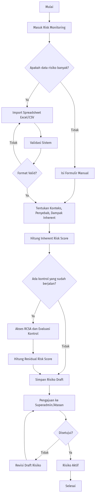
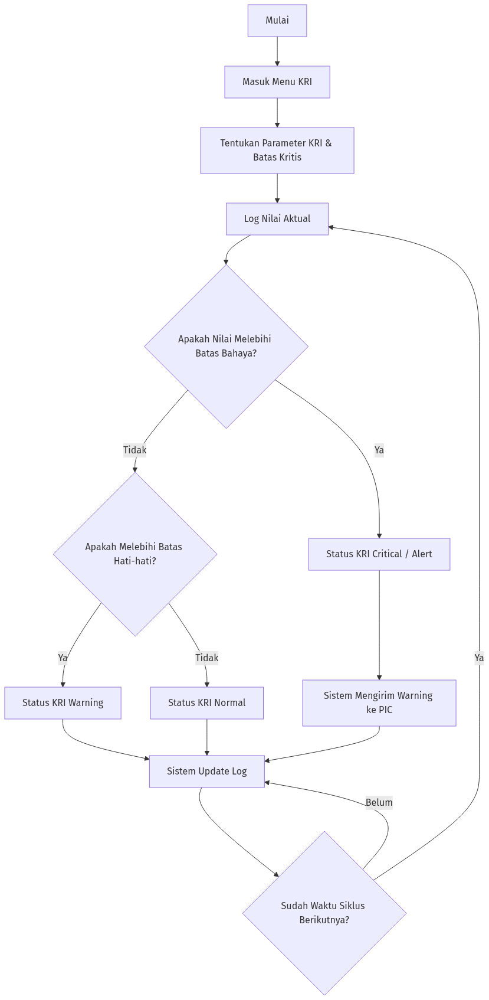
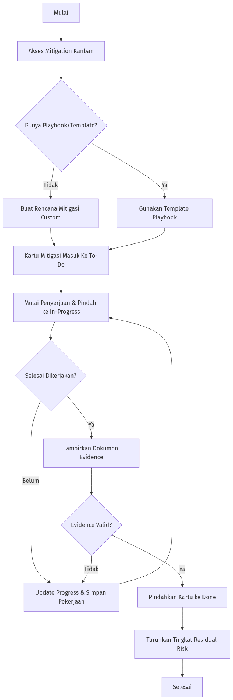
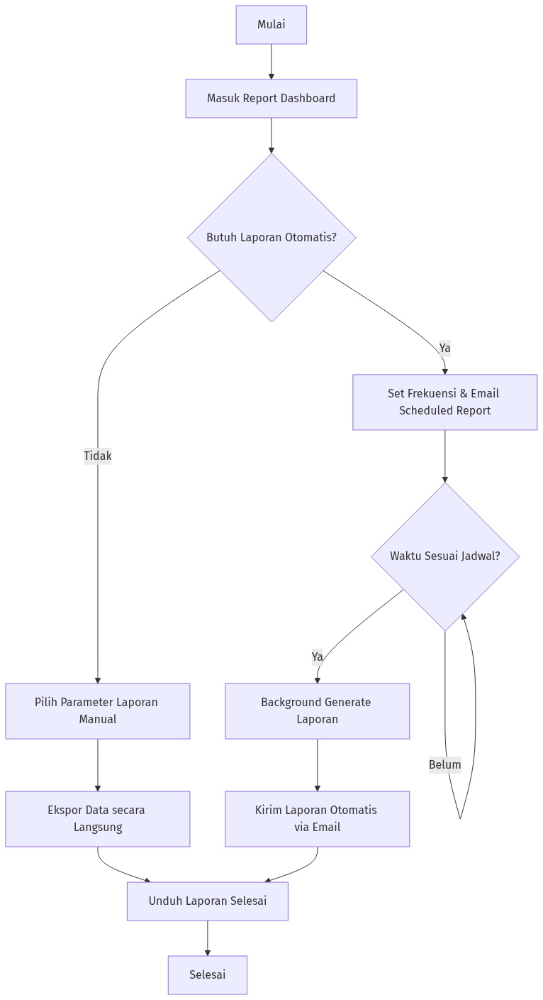
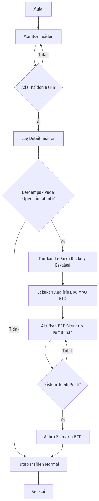
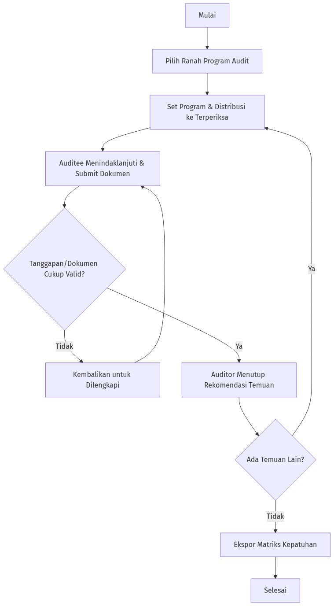
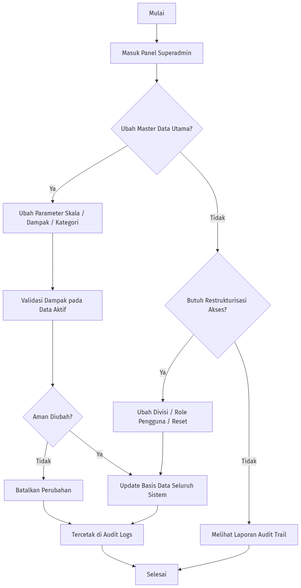

# Flowchart dan Alur Sistem Manajemen Risiko

Berikut adalah dokumentasi alur kerja (flowchart) beserta penjelasan detail untuk setiap fitur atau fungsionalitas utama di dalam Sistem Manajemen Risiko.

---

## 1. Fitur Manajemen Risiko (Identifikasi & Pendaftaran Risiko)

Fitur ini mencakup proses awal pencatatan risiko baru ke dalam sistem, evaluasi kontrol bawaan, hingga penetapan status risiko.

### Flowchart

### Tabel Penjelasan Alur

| Langkah   | Proses                       | Penjelasan                                                                                                                                                         |
| :-------- | :--------------------------- | :----------------------------------------------------------------------------------------------------------------------------------------------------------------- |
| **A - C** | Akses & Pilihan Input        | Pengguna mengakses Dashboard Monitoring Risiko dan memilih untuk menginput risiko satu per satu secara manual atau melalui fitur _bulk import_ (spreadsheet).      |
| **D**     | Import Data                  | Jika memilih import, pengguna mengunggah file template yang sudah berisi daftar risiko yang siap divalidasi sistem.                                                |
| **E - G** | Input Profil Risiko          | Jika manual, pengguna mendeskripsikan secara rinci konteks, penyebab, kategori, serta menentukan level kemungkinan dan besaran dampaknya berdasar matriks.         |
| **H**     | Kalkulasi _Inherent Risk_    | Sistem secara otomatis menghitung tingkat keparahan risiko murni (_Inherent Risk_) sebelum adanya kontrol mitigasi.                                                |
| **I - K** | Evaluasi _RCSA_ & _Residual_ | Pengguna mengevaluasi seberapa efektif kontrol yang saat ini berjalan (Risk Control Self-Assessment), dilanjutkan sistem menghitung sisa risiko (_Residual Risk_). |
| **L - N** | Pengajuan Otoritas           | Risiko disimpan sebagai draf mentah, dan pengguna harus meminta _Approval_ (persetujuan) dari atasan atau Superadmin untuk mengubah statusnya menjadi Aktif.       |
| **O - P** | Keputusan                    | Jika disetujui, risiko resmi dikelola (_Aktif_) dan muncul di Heatmap. Jika ditolak, risiko dikembalikan untuk direvisi.                                           |

---

## 2. Fitur Indikator Risiko Utama (Key Risk Indicator / KRI)

Fitur ini digunakan untuk memantau sinyal peringatan dini (early warning sign) sebelum sebuah risiko benar-benar terjadi atau memburuk.

### Flowchart

### Tabel Penjelasan Alur

| Langkah   | Proses              | Penjelasan                                                                                                                                     |
| :-------- | :------------------ | :--------------------------------------------------------------------------------------------------------------------------------------------- |
| **A - C** | Akses Menu KRI      | Pengguna membuka risiko spesifik dan beralih ke bagian manajemen KRI untuk menentukan tolok ukur risiko tersebut.                              |
| **D - E** | Penentuan Threshold | Pengguna menentukan parameter indikator beserta _threshold_ limitnya (kapan dianggap Hijau/Aman, Kuning/Waspada, atau Merah/Bahaya).           |
| **F - G** | Logging Data        | Secara berkala (harian/mingguan/bulanan), pengguna _log_ nilai riil dilapangan (KRI log value) pada sistem.                                    |
| **H - K** | Otomasi Status      | Sistem membandingkan nilai masukan terhadap threshold, lalu menetapkan status _Normal_, _Warning_, atau _Critical_.                            |
| **L**     | Eskalasi Alert      | Jika status masuk zona bahaya (_Critical_), sistem akan menerbitkan "Risk Alert" spesifik untuk segera ditindaklanjuti.                        |
| **M**     | Analisis Tren       | Seluruh log nilai divisualisasikan dalam bentuk grafik Tren Analysis agar manajemen bisa melihat kemajuan atau kemunduran dari waktu ke waktu. |

---

## 3. Fitur Rencana Aksi & Mitigasi (Mitigation Kanban)

Sistem tata kelola untuk merencanakan, melaksanakan, dan mengontrol tindak turun tangan terhadap risiko (Risk Treatment).

### Flowchart

### Tabel Penjelasan Alur

| Langkah   | Proses             | Penjelasan                                                                                                                                                       |
| :-------- | :----------------- | :--------------------------------------------------------------------------------------------------------------------------------------------------------------- |
| **A - B** | Buka Papan Kerja   | Pengguna masuk ke Mitigation Kanban untuk melihat semua rencana aksi mitigasi dalam bentuk kartu interaktif ala Trello.                                          |
| **C - E** | Pembuatan Mitigasi | Pengguna membuat rencana tindakan yang baru, atau memuatnya dari cetak biru yang sudah pernah dibuat (_Mitigation Playbooks/Templates_).                         |
| **F - G** | Penugasan          | Pengguna menentukan siapa penanggungjawab (Owner Workload), tenggat waktu, dan masuk ke kolom pertama yaitu `To-Do`.                                             |
| **H - K** | Eksekusi & Update  | Saat dikerjakan, kartu ditarik ke `In-Progress`. Di tahap ini, PIC melampirkan berkas bukti implementasi (Evidence) dan log komentar harian.                     |
| **L - M** | Penyelesaian       | Ketika kartu ditarik ke kolom `Done`, rencana mitigasi dianggap beres. Pengguna dianjurkan meninjau & merevisi turun profil _Residual Risk_ di data risiko awal. |

---

## 4. Fitur Pelaporan (Reporting Dashboard & Scheduled Reports)

Fitur sentral untuk menyarikan data mentah sistem ke visualisasi manajemen tingkat tinggi dan laporan representatif korporat.

### Flowchart

### Tabel Penjelasan Alur

| Langkah   | Proses                  | Penjelasan                                                                                                                                                                                                       |
| :-------- | :---------------------- | :--------------------------------------------------------------------------------------------------------------------------------------------------------------------------------------------------------------- |
| **A - C** | Pilihan Laporan         | Pengguna menavigasi ke sisi report, bisa memilih menarik laporan secara insidental (Generate Langsung) atau berlangganan otomatis (Terjadwal).                                                                   |
| **D - I** | Laporan Insidental      | Memilih rentang cakupan (misal: laporan Rangkuman seluruh Board atau sekadar Heatmap Risiko) dan mendownloadnya dalam bentuk PDF, Excel, atau presentasi PowerPoint.                                             |
| **J - L** | Konfigurasi Jadwal      | Pengguna menyiapkan formulir _Scheduled Report_: memilih frekuensi (harian, mingguan, bulanan), format berkas target, dan memasukkan alamat email target (direksi/manajemen).                                    |
| **M - P** | Eksekusi Latar Belakang | Sistem secara pasif akan menunggu waktu berbunyi. Di saat waktu tepat, laporan akan dibangun otomatis oleh mesin server lalu didistribusikan langsung ke kotak masuk email direksi tanpa bantuan tangan manusia. |

---

## 5. Fitur Business Continuity Management (BCM) & Insiden

Fitur ini memitigasi jika suatu risiko parah nyatanya "pecah" menjadi peristiwa / insiden kritis yang menganggu operasional perusahaan.

### Flowchart

### Tabel Penjelasan Alur

| Langkah   | Proses                           | Penjelasan                                                                                                                                                                      |
| :-------- | :------------------------------- | :------------------------------------------------------------------------------------------------------------------------------------------------------------------------------ |
| **A - D** | Pencatatan Insiden               | Dari intelijen ancaman atau pelaporan pengguna, sebuah kejadian tak terduga (_Incident_) dilog ke dalam sistem.                                                                 |
| **E - F** | Tautkan ke Risiko                | Insiden disambungkan ke nomor registrasi Risiko. Analis melihat bahwa probabilitas fiktif sudah jadi insiden aktual, sehingga statusnya eskalasi menjadi Krisis tingkat lanjut. |
| **G - H** | _BIA (Business Impact Analysis)_ | Menilai ulang dampak gangguan dari insiden tersebut ke urat nadi bisnis (Maksimal waktu ngadat, target titik henti operasional - MAO, RTO, RPO).                                |
| **I**     | _BCP (Business Continuity Plan)_ | Menyusun siasat darurat agar perusahaan kembali tegak (contoh: pakai server cadangan, pindah gedung dsb) sesuai prioritas BIA.                                                  |
| **J**     | Pemulihan                        | Jika BCP tereksekusi mulus dan insiden tertangani, _log tiket kejadian_ akan dirapikan lalu ditutup.                                                                            |

---

## 6. Fitur Pengawasan Kepatuhan & Program Audit (Compliance)

Modul untuk memastikan proses bisnis dan tata kelola unit tidak bertentangan dengan kebijakan dan regulator yang berlaku (OJK/Internal).

### Flowchart

### Tabel Penjelasan Alur

| Langkah   | Proses                   | Penjelasan                                                                                                                                                                                                |
| :-------- | :----------------------- | :-------------------------------------------------------------------------------------------------------------------------------------------------------------------------------------------------------- |
| **A - C** | Pemilihan Ranah Audit    | Auditor Internal atau Staf Kepatuhan memilih jenis program evaluasi yang akan dijalani. Apakah inisiatif internal korporat, kepatuhan Manajemen Risiko, atau respon teguran dari instansi pemerintah OJK. |
| **D - G** | Manajemen Temuan         | Auditor bisa mengunggah dan memetakan ruang lingkup masalah atau _Temuan_ secara bulk menggunakan Spreadsheet (_Import Temuan_), dan membuat porsi program.                                               |
| **H - I** | Klarifikasi (Monitoring) | Dashboard akan mencatat poin temuan. Pihak yang diaudit (_Auditee_) diminta sistem untuk memberikan jawaban dan menautkan fail bukti dokumentasi perbaikan kepatuhan.                                     |
| **J - L** | Penutupan Audit          | Auditor mengevaluasi kelengkapan dokumen. Begitu _clear_, poin temuan ditutup. Hasil kompilasi tingkat kematangan kepatuhan bisa di-ekspor komplit (Excel/PDF) via fitur Dashboard Audit.                 |

---

## 7. Fitur Konfigurasi Parameter (Superadmin Pengaturan)

Pusat kendali parameter teknis mendasar dari operasional Manajemen Risiko di seluruh sistem.

### Flowchart

### Tabel Penjelasan Alur

| Langkah   | Proses                | Penjelasan                                                                                                                                                                                                                            |
| :-------- | :-------------------- | :------------------------------------------------------------------------------------------------------------------------------------------------------------------------------------------------------------------------------------ |
| **A - C** | Akses Area Terbatas   | Pengguna dengan _role_ tertinggi superadmin membuka panel `Parameter`. Panel ini mengontrol taksonomi dari seisi aplikasi.                                                                                                            |
| **D - G** | Manipulasi Kamus Data | Mengelola _dropdown list_ / Master Data (seperti menentukan rentang Skala Dampak, Menukar label kemungkinan "Jarang" menjadi "Mustahil", memanipulasi kategori sebab akibat, serta restrukturisasi pohon divisi Organisasi pengguna). |
| **H**     | Manajemen Akun        | Otoritas untuk ganti hak pengguna biasa jadi admin, menghapus pegawai, atau mereset password secara paksa jika lupa akun.                                                                                                             |
| **I - K** | Audit Trails          | Setiap manuver yang mengubah fondasi master-data oleh superadmin, akan permanen di-tulis di _Audit Logs_ yang tidak bisa dihapus guna melindungi keamanan transparan secara teknis.                                                   |

---

_Dokumen ini dibuat dan dikelola untuk memudahkan transisi, pengujian, dan pengembangan lebih lanjut pada Sistem Manajemen Risiko._
